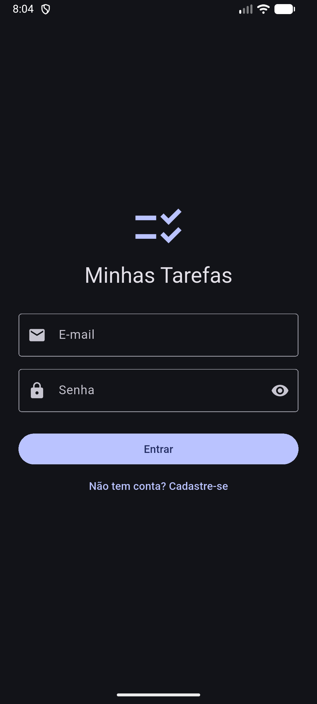
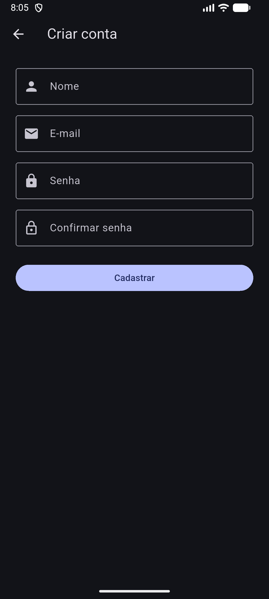
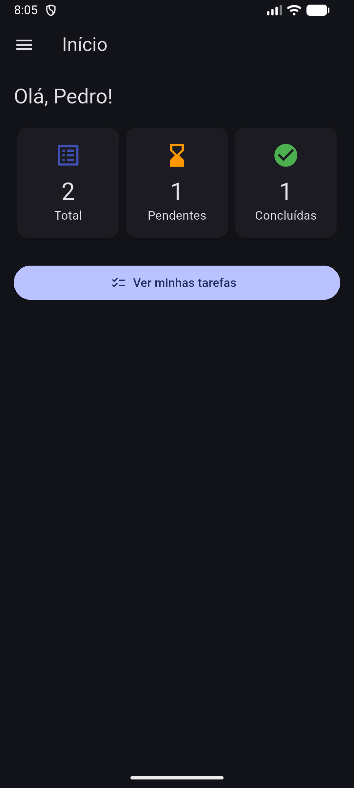
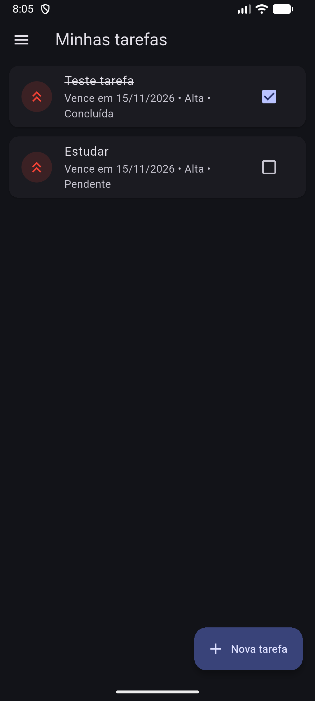
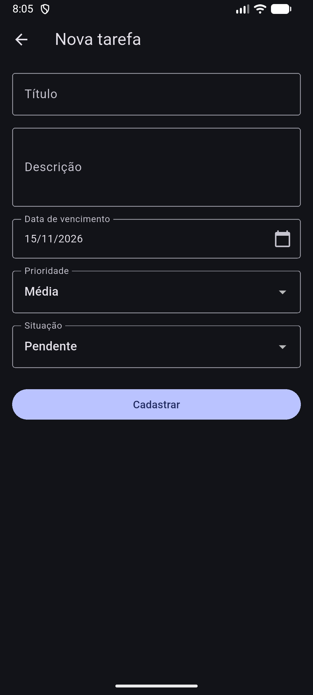

# Minhas Tarefas — P2 Programação Mobile (Flutter + Firebase)

App de gerenciamento de tarefas com autenticação por e-mail/senha, CRUD em tempo real
(Firebase Realtime Database), Drawer, ListView, SharedPreferences e temas claro/escuro.

## Estrutura
```
lib/
├── main.dart                 # inicialização, rotas e AuthGate (mantém sessão)
├── firebase_options.dart     # gerado pelo `flutterfire configure`
├── models/                   # Usuario, Tarefa
├── screens/                  # login, cadastro, home, tarefas, form de tarefa, configurações
├── services/                 # auth_service, firebase_service, preferences_service
├── widgets/drawer_menu.dart
└── themes/app_theme.dart     # lightTheme, darkTheme, ThemeController
```

## Pré-requisitos
- Flutter SDK 3.19+ e um emulador/dispositivo
- Conta Google e Node.js (para o Firebase CLI)

## Configuração do Firebase
1. Crie um projeto em https://console.firebase.google.com.
2. **Authentication** → Método de login → ative **E-mail/senha**.
3. **Realtime Database** → Criar banco de dados (modo bloqueado).
4. Aba **Regras**: cole o conteúdo de `database.rules.json` e publique
   (cada usuário só lê/escreve em `tarefas/{seu uid}`).
5. No terminal, na raiz do projeto:
   ```bash
   npm install -g firebase-tools
   dart pub global activate flutterfire_cli
   firebase login
   flutterfire configure
   ```
   Isso sobrescreve `lib/firebase_options.dart` e baixa o `google-services.json` (Android).
6. Android: confirme `minSdkVersion 23` em `android/app/build.gradle`.

## Executar
Se as pastas `android/`/`ios/` não existirem, gere-as antes:
```bash
flutter create . --platforms=android,ios
flutter pub get
flutter run
```

## Modelo de dados
```
/usuarios/{uid}          -> { nome, email }
/tarefas/{uid}/{id}      -> { titulo, descricao, dataVencimento, prioridade, concluida }
```

## Capturas de tela

### Tela de login


### Cadastro de usuário


### Tela inicial


### Minhas tarefas


### Cadastro de tarefa


